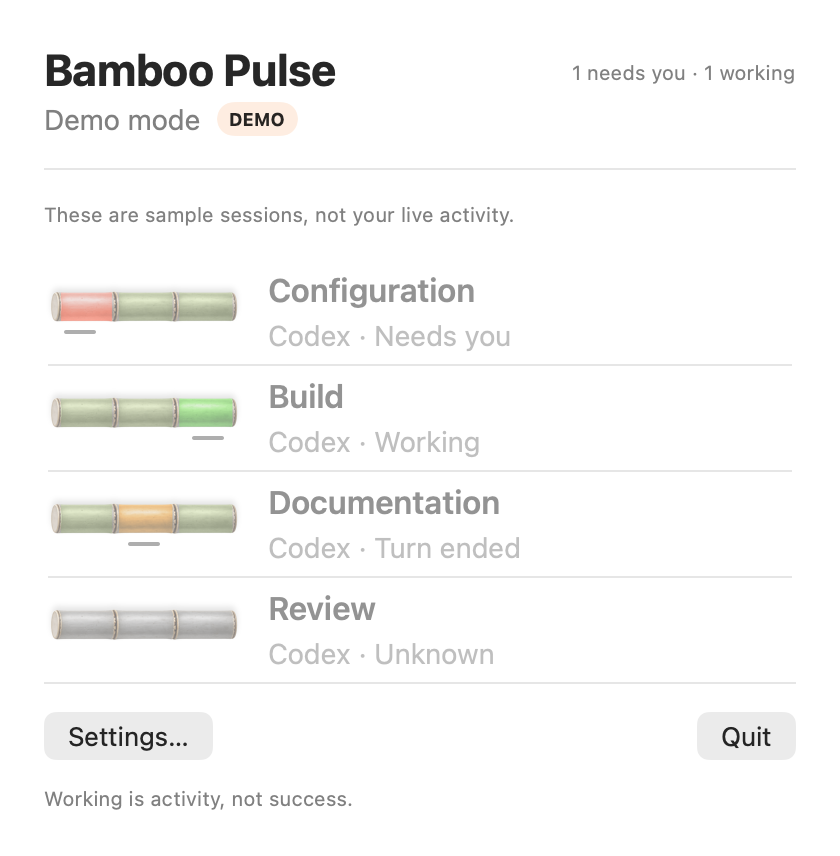

# Bamboo Pulse

Bamboo Pulse is a macOS menu-bar app for following local Codex chats. See which sessions are working, which need a response, and which have ended. Select a live session to open its chat when a valid destination is available.

**Author** · [Dantino](https://dantino.vn) · [MIT license](LICENSE)



*Preview rendering from the app's SwiftUI view with sample data. Live monitoring shows your observed sessions.*

## Start here

Follow the illustrated [Quick Start](docs/quick-start.md) to:

1. [Check requirements and clone the repository](docs/quick-start.md#1-check-requirements-and-get-the-source).
2. [Build and try Preview](docs/quick-start.md#2-build-and-try-preview).
3. [Build an app with the monitoring runtime](docs/quick-start.md#3-build-the-app-with-its-monitoring-runtime).
4. [Enable hooks and the observer](docs/quick-start.md#4-enable-local-codex-monitoring).
5. [Verify live sessions and notifications](docs/quick-start.md#5-verify-monitoring).
6. [Remove monitoring when needed](docs/quick-start.md#6-remove-monitoring).

The current runtime package targets Apple silicon and expects the Codex executable inside `/Applications/ChatGPT.app`. Setup asks for consent before adding Codex hooks and a shell startup block. The guide explains those changes and the recovery steps.

## Try Preview

On a Mac with Xcode and a Swift 6 toolchain:

```sh
git clone https://github.com/tongvtdan/Bamboo-Pulse.git
cd Bamboo-Pulse
./script/build_and_run.sh --preview
```

Click the Bamboo Pulse menu-bar icon. Preview shows labeled sample sessions. For live monitoring, build the runtime bundle and complete [setup](docs/quick-start.md#3-build-the-app-with-its-monitoring-runtime). A plain Xcode build contains the native interface and core library.

## Develop and test

Open `BambooPulse.xcodeproj` and select **Bamboo Pulse Preview** or **Bamboo Pulse Live**. SwiftPM builds PulseCore only.

```sh
swift test
./script/build_and_run.sh --preview --test
./script/build_and_run.sh --live --test
./script/build_and_run.sh --release --build-only
python3 scripts/validate_project.py
```

For packaged runtime tests, set `PULSE_TEST_PAYLOAD` to a new staging path and use the pinned interpreter archive downloaded in the Quick Start. Use Python 3.10 or newer to run the packager. The tests use disposable homes and sockets; desktop forwarding requires the supported Codex executable.

```sh
export PULSE_TEST_PAYLOAD="$(mktemp -d)/PulseRuntime"
python3 Runtime/pulse-runtime/package.py --python-archive "$PULSE_PYTHON_ARCHIVE" --output "$PULSE_TEST_PAYLOAD"
python3 -B -m unittest discover -s Runtime/pulse-runtime/tests
```

See the [contributor workflow](WORKFLOW.md), [behavior and architecture](SPEC.md), [dependency versions and notices](docs/dependencies.md), and [binary release checks](docs/release-checks.md). Report problems through [GitHub issues](https://github.com/tongvtdan/Bamboo-Pulse/issues), using synthetic examples or redacted screenshots.
