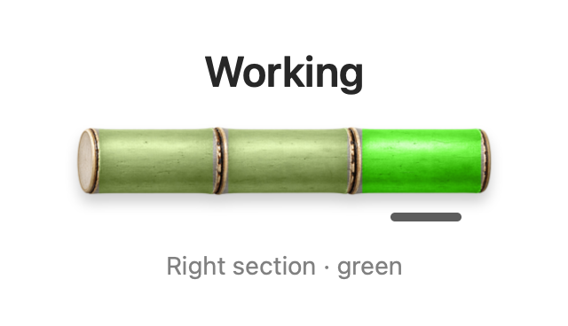
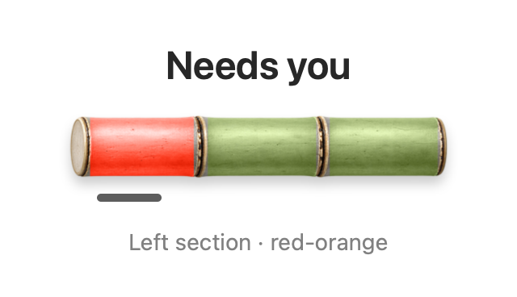
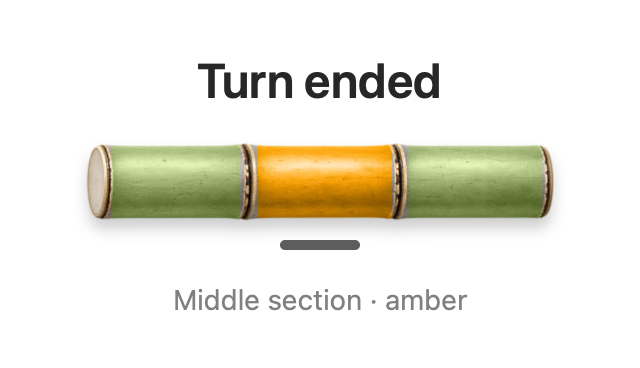

# Bamboo Pulse

Bamboo Pulse is a macOS menu-bar app for following local Codex chats. See which sessions are working, which need your input, and which have finished a turn. Select a live session to open its chat when a valid destination is available.

**Author** · [Dantino](https://dantino.vn) · [MIT license](LICENSE)


## Read the bamboo

In **Normal** layout, each session has a bamboo stalk with three sections. The colored section and underline identify its current state.

| Working | Needs you | Turn ended |
| --- | --- | --- |
|  |  |  |
| Observed work is in progress. | Waiting for your input or permission. | The turn ended. Open the chat to check the result. |

*Enlarged still renders of the app's bamboo views. In the app, Working shimmers and Needs you pulses; Reduce Motion keeps both still.*

**Turn ended does not confirm success.** **Unknown** uses a neutral stalk without an underline when current status cannot be established. These are session states, not a progress bar.

For text labels, open **Settings… → Display → Show session status** (off by default). **Compact** layout uses colored status symbols instead of stalks. See the [Quick Start](docs/quick-start.md#read-the-status) for the full guide.

## Install and enable monitoring

For a packaged release, use an Apple silicon Mac with the supported ChatGPT/Codex desktop app installed at `/Applications/ChatGPT.app`. The DMG includes the monitoring runtime; Xcode and a separate Python installation are needed only when building from source.

1. Download `Bamboo-Pulse-0.1.2-arm64.dmg` from [GitHub Releases](https://github.com/tongvtdan/Bamboo-Pulse/releases), open it, and drag **Bamboo Pulse.app** to **Applications**.
2. Launch Bamboo Pulse from Applications. Click its bamboo menu-bar icon and choose **Enable monitoring** when setup asks.
3. Quit ChatGPT completely and reopen it so it picks up the monitoring configuration.
4. Open a **local Codex chat**. Click **Hooks** beside the message box, review the seven Bamboo Pulse commands, and enable or approve them. With a local project open, you can also find them under **Settings → Hooks**.
5. **After enabling the hooks, quit and reopen both ChatGPT and Bamboo Pulse.** Keep Bamboo Pulse in Applications while monitoring is enabled.
6. Start a new local Codex task. Open the bamboo menu-bar popover and confirm that your session appears without a **DEMO** badge. For text states, enable **Settings… → Display → Show session status**.

See the [Quick Start](docs/quick-start.md#4-enable-local-codex-monitoring) for setup details and consent, notifications, and removal instructions.

## Build from source

Follow the illustrated [Quick Start](docs/quick-start.md) to:

1. [Check requirements and clone the repository](docs/quick-start.md#1-check-requirements-and-get-the-source).
2. [Build and try Preview](docs/quick-start.md#2-build-and-try-preview).
3. [Build an app with the monitoring runtime](docs/quick-start.md#3-build-the-app-with-its-monitoring-runtime).
4. [Enable hooks and the observer](docs/quick-start.md#4-enable-local-codex-monitoring).
5. [Verify live sessions and notifications](docs/quick-start.md#5-verify-monitoring).
6. [Remove monitoring when needed](docs/quick-start.md#6-remove-monitoring).

The current runtime package targets Apple silicon and expects the Codex executable inside `/Applications/ChatGPT.app`. Setup asks for consent before adding Codex hooks and a shell startup block. The guide explains those changes and the recovery steps.

## Try Preview

On a Mac with Xcode and a Swift 6 toolchain:

```sh
git clone https://github.com/tongvtdan/Bamboo-Pulse.git
cd Bamboo-Pulse
./script/build_and_run.sh --preview
```

Click the Bamboo Pulse menu-bar icon. Preview shows labeled sample sessions. For live monitoring, build the runtime bundle and complete [setup](docs/quick-start.md#3-build-the-app-with-its-monitoring-runtime). A plain Xcode build contains the native interface and core library.

## Develop and test

Open `BambooPulse.xcodeproj` and select **Bamboo Pulse Preview** or **Bamboo Pulse Live**. SwiftPM builds PulseCore only.

```sh
swift test
./script/build_and_run.sh --preview --test
./script/build_and_run.sh --live --test
./script/build_and_run.sh --release --build-only
python3 scripts/validate_project.py
```

To regenerate the three status images from the app's SwiftUI views on macOS:

```sh
bash script/render_status_images.sh
```

The renderer uses the app's artwork and labels with fixed sample states, no animation, and a matching underline. It does not connect to a live feed or read chat data.

For packaged runtime tests, set `PULSE_TEST_PAYLOAD` to a new staging path and use the pinned interpreter archive downloaded in the Quick Start. Use Python 3.10 or newer to run the packager. The tests use disposable homes and sockets; desktop forwarding requires the supported Codex executable.

```sh
export PULSE_TEST_PAYLOAD="$(mktemp -d)/PulseRuntime"
python3 Runtime/pulse-runtime/package.py --python-archive "$PULSE_PYTHON_ARCHIVE" --output "$PULSE_TEST_PAYLOAD"
python3 -B -m unittest discover -s Runtime/pulse-runtime/tests
```

See the [contributor workflow](WORKFLOW.md), [behavior and architecture](SPEC.md), [dependency versions and notices](docs/dependencies.md), and [binary release checks](docs/release-checks.md). Report problems through [GitHub issues](https://github.com/tongvtdan/Bamboo-Pulse/issues), using synthetic examples or redacted screenshots.

## FAQ

- **Where is the app window?** Bamboo Pulse runs in the macOS menu bar. Click the bamboo icon to see sessions and open Settings.
- **Do I need Xcode or Python to use the DMG?** No. The packaged app includes its runtime. Building from source requires developer tools.
- **Can I use an Intel Mac?** The bundled runtime targets Apple silicon. A universal native executable does not make the complete package Intel-compatible.
- **Does Turn ended mean the task succeeded?** No. It means the observed turn ended; open the chat and check the result.
- **What does setup change?** With your consent, it adds Bamboo Pulse hooks to `~/.codex/hooks.json` and a startup block to `~/.zshrc`. Use [Manage monitoring to remove them](docs/quick-start.md#6-remove-monitoring) before deleting the app; unrelated configuration is preserved.

## Troubleshooting

| Problem | What to do |
| --- | --- |
| No sessions after enabling hooks | Quit and reopen **both ChatGPT and Bamboo Pulse**, then start a new local Codex task. Confirm the seven Bamboo Pulse hooks are enabled. |
| DEMO badge or sample sessions | Quit Preview and open the packaged app from Applications. Preview does not monitor real chats or open them. |
| Connection unavailable | Confirm setup completed and both apps were restarted after enabling hooks. Check the monitoring message in Pulse Settings. |
| No sessions observed | This can be a valid empty snapshot. Send a new task in a local Codex chat and check again. |
| Updates paused or Unknown | Generate new local activity. Pulse retries automatically; inspect its monitoring message if updates do not resume. |
| No notification | Enable **Notify when a session needs you** in Pulse Settings, allow notifications in macOS, check Focus, and use **Send test notification**. Preview disables notifications. |
| Selecting a session does not open its chat | Open the Codex desktop app once to register it with macOS, then try a fresh observed session. |
| Existing observer or configuration conflict | Keep the existing files and follow the displayed guidance. Avoid manually deleting hooks or shared configuration. |

If the problem persists, [open an issue](https://github.com/tongvtdan/Bamboo-Pulse/issues) with the app version, macOS version, desktop-app version, and failing step. Redact chat contents and personal paths. See the [full troubleshooting guide](docs/quick-start.md#when-a-check-fails).
