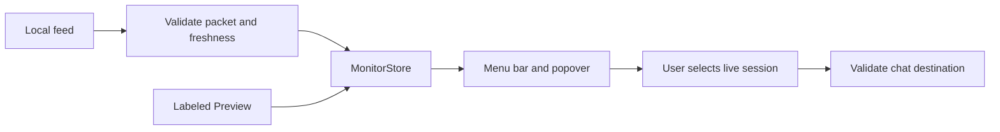

# Bamboo Pulse behavior

A developer can launch Preview, see labeled sample sessions, and change the menu-bar UI on a Mac without a running feed. Live reads session evidence from a compatible local Unix socket. A fresh empty snapshot means no sessions observed. A missing service, invalid packet, or expired snapshot must stay visibly unavailable or unknown.

| Responsibility | Location |
| --- | --- |
| Polling, validation, ordering, expiry and session state | [PulseCore](Sources/PulseCore/) |
| App lifecycle, menu bar, notifications and navigation | [App](Sources/BambooPulse/App/) |
| Display preferences and presentation | [Models](Sources/BambooPulse/Models/) and [Views](Sources/BambooPulse/Views/) |
| Core fixtures and native behavior tests | [Tests](Tests/) |

Only a user action can open a chat. Validate the link for the selected session. Do not infer successful task completion from a turn ending. Preserve the separation between observation, user navigation and setup consent.
