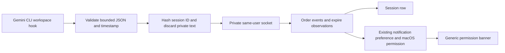

# Gemini CLI maintainer review

16 November 2026, Asia/Saigon. Owner Dan. Prepared by the implementation agent. Dan approved this exact observer candidate for local integration on 16 November 2026 in chat BBX-X-87, replying “Approve for local integration” to the review request. The approval is recorded under [WORKFLOW.md](../WORKFLOW.md).

## Outcome and source

Gemini CLI tool-permission events show Needs you and can deliver a generic macOS banner when notifications are enabled. AfterAgent changes the row to Turn ended and withdraws the permission banner. Users answer requests in their terminal.

The candidate is the standalone Bamboo Pulse working tree on develop, based on commit `656120e34b2bdd4602f884d03f2aa80203115b9b`. The checkout contains uncommitted Gemini changes and pre-existing work. The 60 Swift source/test files match the [live-test source manifest](evidence/gemini-cli-fixed-live-2026-11-16.json). The tested signed Debug executable has SHA-256 `080119250b8dd265e6ec495a9c51bb790917111a5bd8a6e44d1d7fb6f27e645a`.

## Review surfaces

| Surface | Behavior to approve | Source |
| --- | --- | --- |
| Hook process | Reads at most 2 MiB plus one overflow byte for CLI frames. Returns neutral JSON for invalid input. Workspace hook timeout bounds the process. | [App entry point](../Sources/BambooPulse/App/BambooPulseApp.swift) |
| Projection and transport | Requires matching event selector, UUID and whole timestamp. Sends a hashed ID, state and event time. Retains private socket permissions and owner lock. | [GeminiHook](../Sources/PulseCore/GeminiHook.swift) |
| JSON validation | CLI raises its own frame limit. Existing callers retain the 128 KiB default and duplicate-key checks. | [StrictJSON](../Sources/PulseCore/StrictJSON.swift) |
| State and freshness | Rejects stale/future events, deduplicates identical events, invalidates equal-time conflicts, and recovers on newer evidence. State expires after 30 seconds and rows disappear after two minutes. | [MonitorStore](../Sources/PulseCore/MonitorStore.swift) |
| Notifications | Uses existing user preference and macOS authorization. Fresh Gemini permission events work when Codex is unavailable. Resolution, conflict or expiry removes the banner. Notification text is fixed. | [NeedsYouNotifications](../Sources/BambooPulse/App/NeedsYouNotifications.swift) |
| Lifecycle and setup | The live app drains the socket. CLI configuration is a manual workspace merge. The existing Antigravity integration shares the socket and remains part of this source candidate. | [App lifecycle](../Sources/BambooPulse/App/PulseAppDelegate.swift), [setup instructions](gemini-cli.md), [Antigravity setup](gemini-monitoring.md) |

## Verified evidence

- SwiftPM core tests passed, 58 tests including equal-time conflict order, strict timestamps and the 2 MiB boundary.
- Live and Preview Xcode schemes each passed 113 tests. App fixtures cover withdrawal of an active banner after conflicting evidence.
- Unsigned Release build passed. The signed Debug candidate passed the real Gemini CLI 0.62.0 permission prompt, visible banner, approval, subsequent turn ending and banner removal. The installed app was restored.
- Source and tested executable hashes were rechecked when preparing this packet and matched. Documentation validation and diff whitespace checks passed.

The [live evidence](evidence/gemini-cli-fixed-live-2026-11-16.json) records build identity, source hashes, limits and the recovered test-harness precondition failure. The model provider was a local fixture. Banner presence and removal were observed. Exact banner count was unmeasured. This preparation is same-agent review.

## Maintainer decision and remaining delivery

VERIFIED owner approval for local integration. Reviewer Dan, 16 November 2026, disposition “Approve for local integration”. Scope covers the local observer, pseudonymous identifiers, hook startup and notification behavior described above, bound to the source manifest linked in this packet.

The original signed Debug test app lacked `Contents/Resources/PulseRuntime`. After approval, a complete signed Release app was built through the [packaged app workflow](quick-start.md#3-build-the-app-with-its-monitoring-runtime), verified and installed locally with an intact rollback copy. The installed runtime manifest, existing Codex feed and Gemini permission-banner flow passed. BambooX workspace hooks now target the installed executable. [Local integration evidence](evidence/gemini-cli-local-integration-2026-11-16.json). The live test establishes the hook and notification path on this Mac. Clean-Mac installation, public binary release qualification and a live Google model session remain PENDING.

Local integration is complete and verified on this Mac. Existing Gemini CLI sessions must reload workspace hooks. Public release qualification remains pending.
