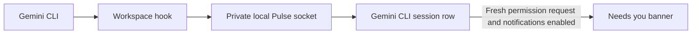

# Monitor Gemini CLI in Bamboo Pulse

Build the current live app and keep it running. In the workspace where you run Gemini CLI, merge these entries into `.gemini/settings.json`. Replace the example executable path with the absolute path to your built app binary. Preserve existing settings and append to any existing event arrays.

```json
{
  "hooks": {
    "Notification": [{
      "matcher": "ToolPermission",
      "hooks": [{
        "name": "bamboo-pulse-permission",
        "type": "command",
        "command": "'/Applications/Bamboo Pulse.app/Contents/MacOS/Bamboo Pulse' --gemini-cli-hook Notification",
        "timeout": 2000
      }]
    }],
    "AfterAgent": [{
      "hooks": [{
        "name": "bamboo-pulse-turn",
        "type": "command",
        "command": "'/Applications/Bamboo Pulse.app/Contents/MacOS/Bamboo Pulse' --gemini-cli-hook AfterAgent",
        "timeout": 2000
      }]
    }]
  }
}
```

Start a new Gemini CLI session in that trusted workspace. Check the two hook names with `/hooks panel`. Enable Needs you notifications in Pulse Settings if you want permission-request banners. Use the terminal to answer the request. A turn ending updates the menu-bar session row. Another turn may follow.



The hook sends a hashed session ID, event time and state. It discards prompts, responses, tool details and transcript paths. Pulse accepts CLI hook frames up to 2 MiB including the prompt and response. Larger frames are dropped. Conflicting events at the same millisecond show Unknown until newer evidence arrives. A quiet session becomes Unknown after 30 seconds and disappears after two minutes. Events while Pulse is closed are dropped. Remove the two named hooks and reload Gemini CLI to disconnect.

See the [Gemini CLI hook schema](https://geminicli.com/docs/hooks/reference/) and [agent-notifications event mapping](https://github.com/777genius/agent-notifications/blob/main/docs/gemini-notifications.md).

## Fixed-build live verification

VERIFIED on 16 November 2026, macOS 27.2.1 with Gemini CLI 0.62.0 and a signed Debug build. The actual CLI displayed a permission prompt against a local model fixture. Pulse displayed the permission banner and removed it after approval and turn end. The installed Pulse app was restored. Banner count was not measured. The test used a disposable home, workspace and file. Human maintainer review remains pending. [Source identity and results](evidence/gemini-cli-fixed-live-2026-11-16.json).
