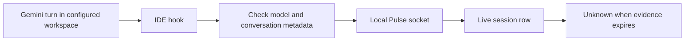

# Gemini in Antigravity IDE

Open the live Bamboo Pulse app. In Settings → Monitoring, choose **Gemini in Antigravity IDE…** and select the local workspace you use for coding. Pulse shows the workspace name before creating its two hooks. Keep Pulse at the same location so the hook commands can find it. Open a Gemini conversation in that workspace and start a turn. If the IDE has already loaded its customizations, verify the hooks in the agent panel’s Customizations → Hooks.

When a workspace already has a hooks file, Pulse offers to copy its named JSON group. Merge that group into the existing top-level object. To disconnect, use the same Settings button. For a merged file, remove only the `bamboo-pulse-gemini` group yourself. Workspace hook files contain the local path to your Pulse executable. Review them before committing them to a shared repository.

| Pulse state | Evidence |
| --- | --- |
| Working | A recent invocation reported a Gemini model in the configured workspace. |
| Turn ended | The same source reported a stop with the boolean idle flag set to true. |
| Unknown | Evidence expired, became ambiguous, or the chat switched models. |

Pulse keeps a chat visible for two minutes after its last observation. After 30 seconds without evidence, its state becomes Unknown. A long generation and a cancelled turn can both go quiet. Hooks provide no verified pending-input signal or direct link to the IDE conversation. Use Antigravity IDE for the chat itself. Codex handles its existing notifications and navigation separately.

The hook checks the reported model on each event and discards prompts, responses, tool arguments and paths. It sends only a provider-scoped chat identifier, observed state and time through a private local socket. It never opens the transcript. The live app keeps the rows in memory. The Antigravity IDE version tested uses a transcript location shared with the desktop app, so a path alone cannot identify the client. Monitoring is scoped to the configured workspace and reported model.

See [Google’s IDE hook reference](https://antigravity.google/docs/hooks?tab=ide) for the supported lifecycle events.
