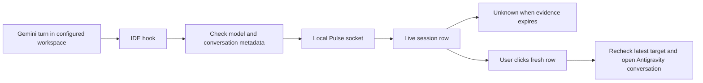

# Gemini in Antigravity IDE

Open the live Bamboo Pulse app. In Settings → Monitoring, choose **Gemini in Antigravity IDE…** and select the local workspace you use for coding. Pulse shows the workspace name before creating its two hooks. Keep Pulse at the same location so the hook commands can find it. Open a Gemini conversation in that workspace and start a turn. If the IDE has already loaded its customizations, verify the hooks in the agent panel’s Customizations → Hooks.

When a workspace already has a hooks file, Pulse offers to copy its named JSON group. Merge that group into the existing top-level object. To disconnect, use the same Settings button. For a merged file, remove only the `bamboo-pulse-gemini` group yourself. Workspace hook files contain the local path to your Pulse executable. Review them before committing them to a shared repository.

| Pulse state | Evidence |
| --- | --- |
| Working | A recent invocation reported a Gemini model in the configured workspace. |
| Turn ended | The same source reported a stop with the boolean idle flag set to true. |
| Unknown | Evidence expired, became ambiguous, or the chat switched models. |

Pulse keeps a chat visible for two minutes after its last observation. After 30 seconds without evidence, its state becomes Unknown. A long generation and a cancelled turn can both go quiet. Click a fresh Gemini row to open its conversation in Antigravity IDE. Quiet, expired and legacy observations without a navigation target remain unavailable for opening. Hooks provide no verified pending-input signal. Codex handles its existing notifications and navigation separately.

The hook checks the reported model on each event and discards prompts, responses, tool arguments and transcript paths. It sends a provider-scoped chat identifier, observed state and time through a private local socket. Fresh IDE events additionally carry the conversation UUID and configured workspace for click navigation. Pulse retains those targets in memory through the two-minute observation cache. Row navigation becomes unavailable when evidence expires or becomes Unknown. It never opens the transcript. The live app keeps the rows in memory. The Antigravity IDE version tested uses a transcript location shared with the desktop app, so a path alone cannot identify the client. Monitoring is scoped to the configured workspace and reported model.

See [Google’s IDE hook reference](https://antigravity.google/docs/hooks?tab=ide) for the supported lifecycle events.

## Conversation navigation

The installed Antigravity IDE 1.11.0 extension builds its own notification links using the registered antigravity-ide scheme, google.google-antigravity authority and open-conversation path, with cascadeId and path query items. Pulse constructs this same local route from validated hook metadata. It verifies the conversation UUID matches the row identifier, checks the latest session and its monotonic expiry at click time, and opens the link using the registered Antigravity IDE application. The link only selects the existing conversation.

Native route compatibility must be checked against the installed IDE. A missing IDE or rejected open operation produces an actionable error. Gemini CLI observations provide state notifications and have no IDE destination. Dan approved the added navigation metadata for local integration on 16 November 2026. The complete signed app is installed locally.

The native route opened the matching conversation in the BambooX workspace during the 16 November 2026 check. After local installation, Dan reported “Correct conversation opens” when clicking the row after a fresh IDE turn. Automated checks passed 59 core tests and 114 tests in each app scheme. [Candidate source identity and navigation evidence](evidence/gemini-ide-navigation-2026-11-16.json).
