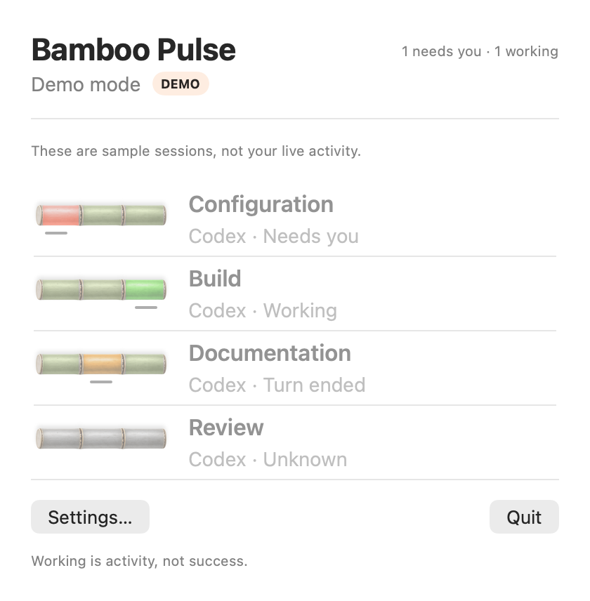
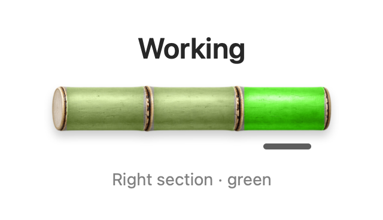
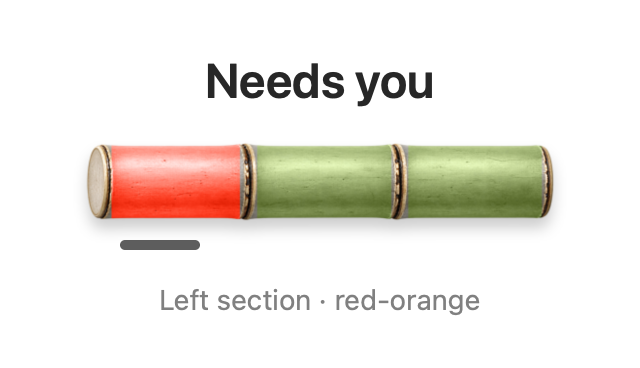
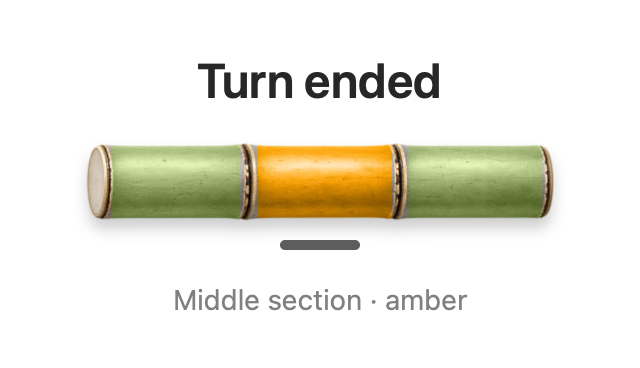
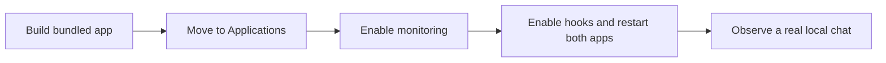

# Bamboo Pulse Quick Start

Build Bamboo Pulse, enable monitoring for local Codex chats, and check the result. Author · [Dantino](https://dantino.vn).

## Install a downloaded release

The packaged app includes its monitoring runtime. You do not need Xcode, Git, or a separate Python installation to use it. Use an Apple silicon Mac with the supported ChatGPT/Codex desktop app installed at `/Applications/ChatGPT.app`.

1. Download the DMG from [GitHub Releases](https://github.com/tongvtdan/Bamboo-Pulse/releases).
2. Open it, drag **Bamboo Pulse.app** to **Applications**, and launch that installed copy. Keep it there while monitoring is enabled.
3. Follow [Enable local Codex monitoring](#4-enable-local-codex-monitoring), including hook approval and restarting **both ChatGPT and Bamboo Pulse** afterward.
4. [Verify a real session](#5-verify-monitoring).

The numbered build sections below are for contributors building from source.

## 1. Check requirements and get the source

You need an Apple silicon Mac for the bundled monitoring runtime, Xcode with a Swift 6 toolchain, Python 3.10 or newer for packaging, and Git. The app's deployment target is macOS 14. Hosted build checks run on macOS 15; qualify your own macOS and desktop-app combination before relying on it.

Live monitoring expects ChatGPT installed at `/Applications/ChatGPT.app`, including its bundled Codex executable. Opening a session from Pulse also requires the Codex app registered with macOS. Open the desktop app once before setup. This guide covers local Codex chats in the desktop app.

In Terminal, check the tools and expected executable:

```sh
uname -m
xcodebuild -version
swift --version
python3 --version
test -x /Applications/ChatGPT.app/Contents/Resources/codex-cli/CodexCLI.app/Contents/MacOS/codex && echo 'Codex executable found'
```

`uname -m` should show `arm64`. Check that Python is at least 3.10. If the executable check prints nothing, confirm the desktop app's location and version before enabling monitoring.

```sh
git clone https://github.com/tongvtdan/Bamboo-Pulse.git
cd Bamboo-Pulse
```

Run the following commands from this repository folder.

## 2. Build and try Preview

```sh
./script/build_and_run.sh --preview
```

Click the bamboo icon in the macOS menu bar. The popover shows a **DEMO** badge and four sample sessions. The app runs in the menu bar, so look there when no main window appears.



*Rendered from the app's actual SwiftUI Preview view using sample data. The state labels are enabled for this image. These sessions demonstrate the interface.*

### Read the status

Open **Settings… → Display**, keep **Layout** set to **Normal**, and turn on **Show session status** to display the state beside each session. Status text is off by default. **Show session labels** controls the session alias (such as `CX1`), not the state.

| Working | Needs you | Turn ended |
| --- | --- | --- |
|  |  |  |
| Recent observed work is in progress. | The observed session is waiting for input or permission. | The observed turn ended. Check the chat for its result. |

*Enlarged still renders of the app's actual bamboo views, using fixed sample states. These are a visual guide, not live session evidence.*

Each stalk represents one session. Its three sections are status indicators, not steps in a progress bar:

- **Working:** the right section is green and shimmers while visible.
- **Needs you:** the left section is red-orange and pulses while visible. Return to the chat to respond.
- **Turn ended:** the middle section is amber and stays still. This does not confirm that the task succeeded or that the chat is closed.
- **Unknown:** the stalk stays neutral with no active underline. Current status cannot be established; check the monitoring message and the chat.

The underline marks the active section without relying on color alone. macOS **Reduce Motion** stops the shimmer and pulse while preserving the color and underline. **Compact** layout replaces stalks with colored symbols: a green circle, red-orange exclamation mark, amber minus, or gray question mark.

Preview uses sample sessions; selecting them cannot open a real chat. Quit Preview using **Quit** before opening your packaged copy.

## 3. Build the app with its monitoring runtime

The package includes the observer, hooks, local feed, setup helper, and Python interpreter. Download the pinned Python archive. The packager checks its SHA-256 before extracting it and includes dependency notices. [Dependency details](dependencies.md)

```sh
mkdir -p .build/quick-start
export PULSE_PYTHON_ARCHIVE="$PWD/.build/quick-start/cpython-3.11.15-macos-arm64.tar.zst"
curl --fail --location \
  'https://github.com/astral-sh/python-build-standalone/releases/download/20260602/cpython-3.11.15%2B20260602-aarch64-apple-darwin-pgo%2Blto-full.tar.zst' \
  --output "$PULSE_PYTHON_ARCHIVE"
export BAMBOO_PULSE_BUILD_ROOT="$PWD/.build/quick-start/xcode"
Runtime/pulse-runtime/build-review-dmg.sh \
  "$PULSE_PYTHON_ARCHIVE" \
  "$PWD/.build/quick-start/Bamboo-Pulse-local.dmg"
```

The last command builds a local unsigned disk image. It requires a new output filename; choose another filename if you build again. Developer ID signing and notarization belong to the [binary release process](release-checks.md).

Open `.build/quick-start/Bamboo-Pulse-local.dmg` in Finder. Drag **Bamboo Pulse.app** to **Applications**, then open `/Applications/Bamboo Pulse.app`. Quit any other Pulse copy first. Setup requires this Applications location because the hooks reference files inside the app bundle. Keep the app there while monitoring is enabled.

If macOS prevents this locally built copy from opening, record the exact message and use Xcode's signing tools with your own development identity. Ask for help through the repository issues if needed.



## 4. Enable local Codex monitoring

1. In Pulse, read **Set up Codex monitoring**, then choose **Enable monitoring**. **Set up later** lets you defer it.
2. Quit ChatGPT completely and reopen it. This lets the desktop process pick up the observer configuration.
3. Open a **local Codex chat**. Click the **Hooks** icon beside the message box and review the seven Bamboo Pulse commands. With a local project open, **Settings → Hooks** also lists them. Enable or approve these commands through the desktop app's hook controls if prompted.
4. **After enabling or approving the hooks, quit and reopen both ChatGPT and Bamboo Pulse.** Closing a window alone does not quit the app.
5. Start a new local Codex task, then open Pulse's menu-bar popover to check that the session appears without a **DEMO** badge.

Setup adds seven event hooks to `~/.codex/hooks.json` and a startup block to `~/.zshrc`. The events are `SessionStart`, `UserPromptSubmit`, `PreToolUse`, `PermissionRequest`, `PostToolUse`, `Stop`, and `Interrupt`. The observer follows the supported local Codex process and supplies session status to Pulse. Pulse reads local chat titles and status for display. Its setup component records its changes so removal can preserve other configuration.

If setup finds an existing observer, follow the displayed message. If you deliberately choose **Use existing monitoring**, restart Pulse to use that source. Its setup remains managed by the service that created it. Keep existing configuration when a conflict or verification error appears, and report the message before attempting manual cleanup.

## 5. Verify monitoring

Open a local Codex chat after restarting both apps following hook approval. Send a small task, such as asking it to describe a file in your project. Open Pulse's menu-bar popover while it works.

Check the following observable results:

- The popover shows live monitoring without the **DEMO** badge.
- Your local chat appears and its state updates as activity arrives.
- Selecting its row opens that same chat.
- When Codex asks for input or permission, leave the prompt unanswered and check for **Needs you**. Respond in Codex and confirm that Pulse updates afterward.
- After a turn finishes, inspect both its Pulse state and the actual result in the chat.

Use the [status guide](#read-the-status) to compare each bamboo indicator. If state text is missing, enable **Show session status** in Settings.

Session counts can be empty while monitoring is available. Generate new activity before concluding that observation failed. When updates become invalid or stale, Pulse shows recovery guidance and marks previous status Unknown.

### Optional notifications

Open Pulse **Settings…**, enable **Notify when a session needs you**, and allow notifications when macOS asks. Choose **Send test notification**. Click the notification and confirm that Pulse opens. If alerts are blocked, check Bamboo Pulse under macOS **System Settings → Notifications**, including the current Focus mode.

Preview disables notifications. Use the packaged live app for this check.

### When a check fails

| What you see | What to check |
| --- | --- |
| DEMO badge | Quit Preview and open the packaged app from Applications. |
| No Manage monitoring button | Confirm this app contains `Contents/Resources/PulseRuntime`; rebuild the package if absent. |
| No sessions after enabling hooks | Quit and reopen both ChatGPT and Bamboo Pulse, then start a new local Codex task. Confirm the seven Bamboo Pulse hooks are enabled. |
| Connection unavailable | Confirm setup completed, the hooks are enabled, and both ChatGPT and Bamboo Pulse were fully reopened after hook approval. |
| Updates paused or Unknown | Generate new local activity. Pulse retries automatically; use Settings to inspect its monitoring message. |
| Existing observer or configuration error | Retain the existing files and report the exact message. |
| Chat fails to open | Open the Codex app once, then try a fresh observed session. |

Include the source commit, app version, macOS version, desktop-app version, and failing step in a [bug report](https://github.com/tongvtdan/Bamboo-Pulse/issues). Redact chat contents and personal paths.

## 6. Remove monitoring

While the installed app is still in Applications:

1. Open the Pulse popover and choose **Settings…**.
2. Under **Monitoring**, select **Manage monitoring…**.
3. In **Remove Codex monitoring?**, choose **Remove monitoring**.
4. Quit and reopen the desktop app to finish disconnecting. Quit Pulse afterward if you want to remove the app from Applications.

Removal deletes Pulse's own hook entries and shell startup block, preserving unrelated entries. Observer metadata and setup records can remain under `~/Library/Application Support/BambooPulse`; removing monitoring does not promise deletion of all app data. If removal reports changed or unverifiable configuration, retain the files and ask for help.

If Settings says **Using existing local monitoring**, that source has its own configuration owner. Use that source's removal process rather than deleting shared configuration.

Return to the [README](../README.md) for developer checks and contribution links.
